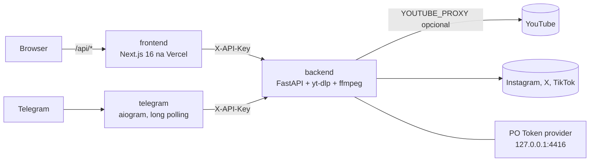

# Arquitetura

Monorepo com três workspaces independentes que conversam só por HTTP:



| Workspace | Stack | Entrada | Responsabilidade |
|---|---|---|---|
| `backend/` | Python 3.12, FastAPI, yt-dlp (biblioteca), ffmpeg | `app/main.py` | Única peça que toca yt-dlp/ffmpeg. Jobs em memória. |
| `frontend/` | Next.js 16 (App Router), React 19, Tailwind 4, Zod, Biome | `src/app/` | UI (Download e Cut & Crop). Os route handlers `src/app/api/*` são um proxy server-side do backend. |
| `telegram/` | Python 3.12, aiogram 3, httpx | `app/main.py` | Mesmo fluxo de download via chat, restrito por allowlist. |

## Backend por camada

```
routers/  ->  services/  ->  yt-dlp / ffmpeg
   |             |
platforms.py  errors.py (taxonomia)   utils/ (cookies, filenames, streaming)
```

- **`app/platforms.py`**: registro único das plataformas (domínios aceitos + allowlist de extractors do yt-dlp). `routers/platforms.py` gera as rotas de cada uma a partir dele.
- **`services/downloader.py`** (`VideoDownloadService`): monta as opções do yt-dlp, roda em `asyncio.to_thread`, traduz erros. No YouTube tenta sem cookies e, só se cair no bot-check, com os cookies configurados.
- **`services/jobs.py`**: jobs em background (download simples ou clipes de 60s) com progresso por polling. Registro em memória, TTL de 1h, limite `MAX_CONCURRENT_JOBS`. Por isso o backend roda com **1 worker**.
- **`services/editor.py`**: ffmpeg/ffprobe via `subprocess.run` em thread (o `SelectorEventLoop` do Windows não suporta subprocess assíncrono). Cut & crop e fatiamento em clipes com keyframes forçados (nenhum clipe passa de 60,5s).
- **`errors.py`**: toda falha vira `AppError` com `{detail, error_type}` + status HTTP. Os códigos são espelhados em `frontend/src/lib/errors.ts` e `telegram/app/errors.py` (testes garantem a sincronia no bot).

## Fluxo de um download com progresso

1. `POST /api/v1/{plataforma}/download/start` → valida o host → cria o job → devolve `job_id`.
2. O cliente faz polling em `GET /api/v1/downloads/{job_id}` (`percent`, `phase`, `speed`, `eta`).
3. `finished` → `GET .../file` transmite em blocos de 1 MiB e apaga o arquivo (modo clipes: `.../clips/{i}/file` e `.../zip`, apagados pelo TTL).

Nomes entregues: `VIDEO_<TITULO>.mp4` / `AUDIO_<TITULO>.mp3` (ASCII, caixa alta), com `filename*` UTF-8 no header.

## Infra

- `infra/docker/*.Dockerfile`: imagens com contexto na raiz do repo (cada uma com seu `.dockerignore` em allowlist).
- `infra/docker-compose.yml` (dev, hot-reload) e `infra/docker-compose.prod.yml` (portas só em `127.0.0.1`, atrás do Caddy).
- Produção atual: backend + bot + PO Token nativos via PM2 numa VPS (ver [deployment.md](deployment.md)); frontend na Vercel.
